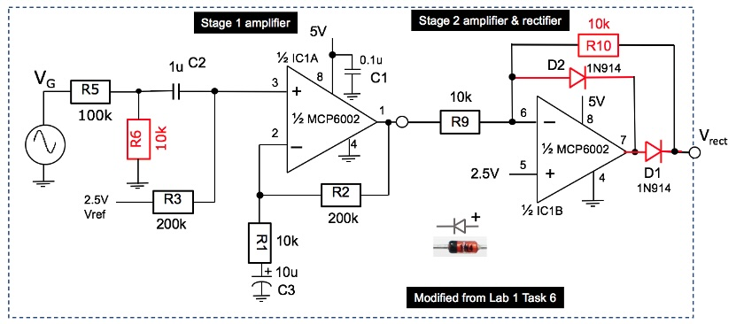
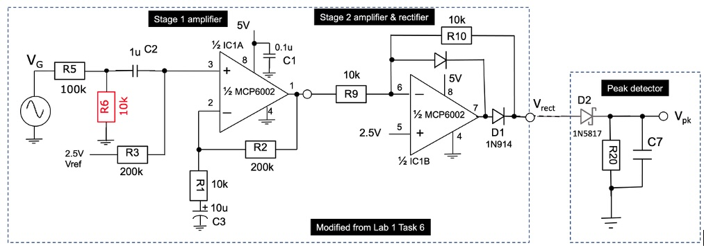
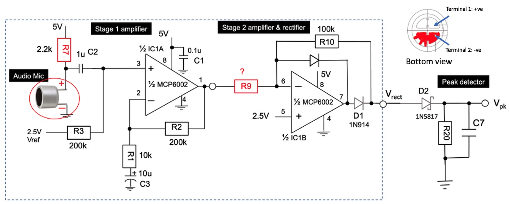
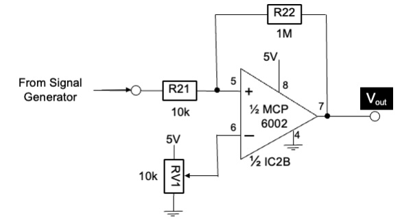
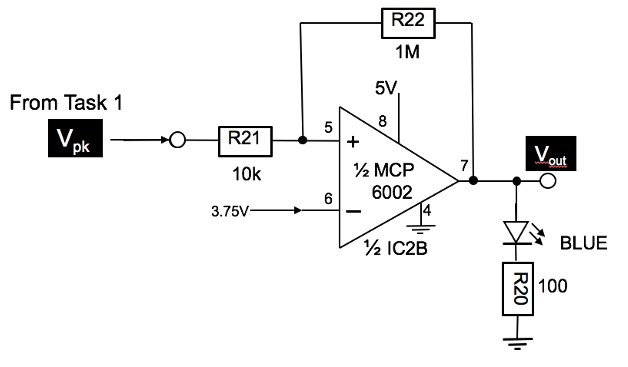
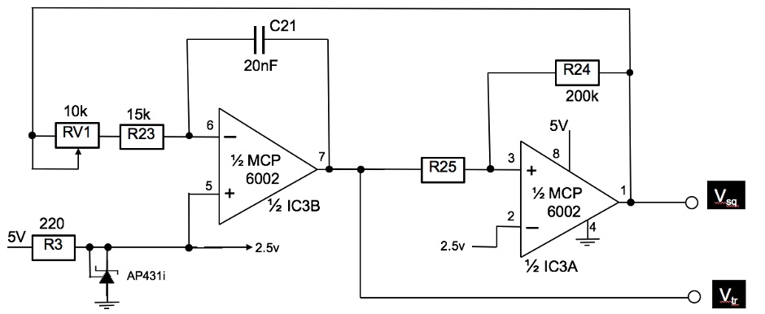
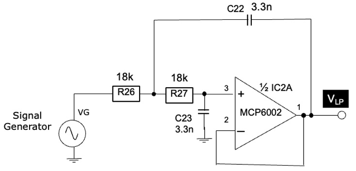
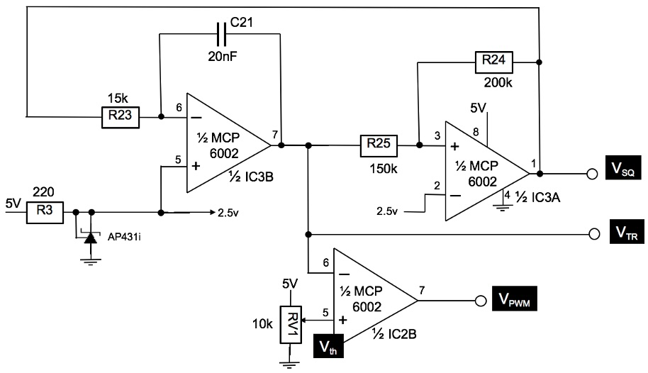

##### Department of Electrical & Electronic Engineering
##### Imperial College London

#### **ELEC50001 Circuits & Systems**

### **Lab 2 - Op-amp Applications**
##### *Peter Cheung, v2.0 - 19 October 2026*

#### **Introduction**

In this laboratory experiment, you will learn how op-amps are used as building blocks to implement different type of circuits beyond amplification of signals.  You will construct and test:

* a rectifier and a peak detector circuit;
* an analogue comparator with hysteresis;
* a triangular and square wave generator;
* a lowpass active filter;
* a pulse-width modulator circuit.

#### **Important Tips**

You should construct your circuits in such a way that you only use around one quarter of the breadboard for each 8-pin integrated circuits. If you do not build your circuit compactly, you will run out of space on the breadboard.  By the end of this lab, your breadboard will have four ICs  working together.  Further, do not disconnect the amplifier you built in Lab 1 and keep the circuit you build for this Lab. You will be needing them in later labs.

> Although not compulsory, you may choose to use **LTSpice** to confirm the expected waveforms where appropriate.

---
#### **Task 1: Rectifier and peak detector**
---
**Step 1:** Modify the 2 stage amplifier you built in Lab1 Task 6 by changing R6 from 1k to 10k, R10 from 100k to 10k, and add the two IN914 diodes as shown below.  Connect the input of this amplifier to signal generating a 1kHz sinewave with 0.9V amplitude and 0V DC offset.

> Explain the output signal Vrect. 

  

**Step 2:**  Add the peak detector (D2, R20, C7) to the output of the rectifier as shown below.   choose appropriate values for R20 and C7 from  the components available to you in the Lab-in-a-Box for this peak detector assuming that the lowest signal frequency is around 100Hz. 

  

>**ADDITIONAL NOTE:**  To reduce the loss in detected voltage due to the forward voltage drop of diode D2, DO NOT USE 1N914, which is normal small signal diode with 0.7V forward voltage. Instead, pick up a 1N5817 schottky diode from the component rack in the Lab.  This diode has a forward voltage of around 0.3V at 100mA.  As a result, the drop in detected peak voltage will be much smaller.

**Step 3:** Connect the input of Stage 1 amplifier to the microphone (instead of the signal generator).  Choose a value for R9 such that the maximum voltage at Vrect is around 4V. Test this circuit by feeding sound to the microphone.  

> _**Hint:** One easy way to do this is download a free tuning fork app to your phone and play a pure tone at say, 1kHz._ 

Note that the microphone has polarity.  The -ve terminal can be identified as the one is connected to the CASE of the microphone as shown here.  This should be connected to GND.  You can download a copy of the specification for this microphone from the course webpage.

  

>Verify that Vpk is as you expected.  

---
#### **Task 2: Building an analogue voltage comparator & audio signal detector**
---

**Step 1:** Use a second MCP6002 device (IC2) provided in the Lab-in-a-Box and build the voltage comparator circuit as shown below. 

  

Set the signal generator to produce a sine wave at 1kHz with 1V amplitude and 1V DC offset.  Adjust the variable resistor RV1 and observe the output Vout.  What is the signal voltages at which the output changes states?  Explain your observations and why the threshold voltages of the comparator changes depending on the output state of the comparator.

Increase the signal frequency and observe what happens.  

>What are the rise and fall times of the output of the comparator?  Does this agree with the MCP6002 data sheet?

**Step 2:** Replace the generated signal with the peak detected signal Vpk from Task 1 Step 3 as shown.   Replace the variable resistor RV1 with a fixed voltage at around 3.75V using a voltage divider. (You will need RV1 for something else later.) 

Connect the BLUE LED at the output as shown.  Verify that BLUE LED indicates the presence or absence of sound picked up by the microphone. For example, the LED should flash when you clap your hands.

  

---
#### **Task 3: Function Generator**
---

**Step 1:** Contruct the circuit shown below using the THIRD MCP6002 provided.   R25 should be 100k for now.  (You must leave the other two MCP6002 chips (IC1 and IC2) alone because you will need them later.)

  

The first stage op-amp is used as an integrator. 

> Derive the maximum and minimum slope for the signal at pin 7 with RV1 set to 0 $\Omega$ and to 10k $\Omega$.  

The second stage op-amp is used as a voltage comparator. 

>Derive its threshold voltages (i.e. the voltage at which the output switches state).

>Hence, deduce the frequency range of the generated triangular and square signals when the loop is closed by connecting the output of the comparator (pin 1) to the input of the integrator.  

**Step 2:** Modify R25 to 150k.  Explain the resulting triangular and square signals.

>Answer the follwing two questions. What determines: 1) the amplitude of the triangular signal? 2) the frequency of oscillation?

---
#### **Task 4:  Lowpass Active Filter: Salley-Key architecture**
---

Shown below is a basic Salley-Key lowpass filter.  Assuming that R26 = R27 = 18k $\Omega$, verify that the cut-off frequency of this lowpass filter is around 2.7kHz, and the DC gain is 0dB.  Construct this circuit using the unused 2nd MCP6002 from Task 2. Note that this is NOT a Butterworth filter, therefore the gain at the cut-off frequency is not -3dB but lower.

Using the waveform generator of the scope, measure the gain of this filter for the frequency range of 10Hz to 100kHz.  Plot the amplitude response of this filter (in dB) vs log frequency.  Explain the results.  (You should use the “measure” feature of the scope to make this task easier.)

  

Connect the triangular signal from Task 3 to the input of this filter.  You should now have a function generator that produces three types of waveforms: triangular, square and sine.

**Optional** - If you have time, you might explore changing the op-amp to have a gain that is NOT x1 only.   You should try the following K values:  K = 1.58, 2 and 2.5.  Find out the filter responses for these filters and their corresponding Q values. 

---
#### **Task 5:  Analogue Pulse-width Modulator Circuit**
---

Use the second op-amp in the 2nd MCP6002 and construct a simple comparator as shown below.  Connect the triangular signal from Task 3  (with RV1 removed) to the negative input of the comparator.  Use the RV1 as a variable DC threshold to the positive input of the comparator.  You should observe a pulse-width modulated signal at the output of the comparator.  State the relationship between the pulse width and the threshold voltage Vth.

  

>What is the relationship between Vth and average voltage (i.e. the DC voltage) of V_pwm? 

The lowpass filter from Task 4 perform an averaging function. 

Connect VPWM to the input of the lowpass filter from Task 4.  Explain the results.  Now change R23 from 15k to 1.5k and explain why there is a difference to V_LP.